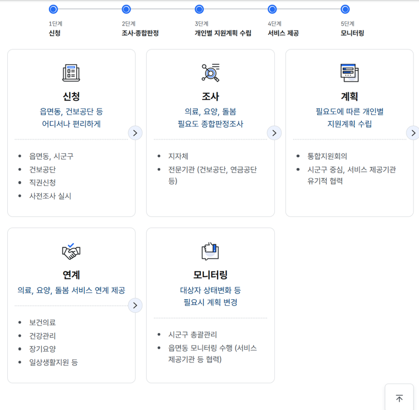

# Dolbom-eum 돌봄e음

A public service platform simplifying access to integrated community care.

돌봄e음 팀의 프로젝트 계획과 산출물을 관리하는 저장소입니다.

## 로컬 개발 실행

Node.js 22.12 이상과 Python 3.12가 필요합니다. DEV-01 실행 확인에는 Windows PowerShell, Node.js 22.15.1, npm 10.9.2, Python 3.12.10을 사용했습니다.

저장소 루트에서 API를 시작합니다.

```powershell
python -m venv .venv
.\.venv\Scripts\python.exe -m pip install -r backend/requirements.txt
$env:PYTHONPATH = "backend"; .\.venv\Scripts\python.exe -m app.db init
$env:DOLBOMEUM_DEMO_PASSWORD = "<팀 카톡방에서 받은 가상 계정 비밀번호>"; .\.venv\Scripts\python.exe -m app.db seed
.\.venv\Scripts\python.exe -m uvicorn app.main:app --app-dir backend --host 127.0.0.1 --port 8000
```

`app.db init`은 SQLite 스키마를 만들고 기존 데이터는 유지합니다. 기본 경로는 저장소의 `var/dolbomeum.sqlite3`(git 제외)이고, `DOLBOMEUM_DB_PATH` 환경값으로 바꿀 수 있습니다. `init --reset`은 지정 경로의 DB를 지우고 새로 만들고, `backup <파일>`은 실행 중에도 일관된 사본을 만듭니다. 테스트는 `backend/requirements-dev.txt`를 설치한 뒤 `backend` 폴더에서 `python -m pytest`로 실행합니다.

`app.db seed`는 C-01·C-06 예제의 가상 계정 4개(`demo-town-a`, `demo-town-a2`, `demo-district-a`, `demo-town-b`)와 프로필 `DEMO-ELDER-01`을 만듭니다. 네 계정은 `DOLBOMEUM_DEMO_PASSWORD`(8자 이상)를 같은 비밀번호로 사용하며, 비밀번호는 저장소에 두지 않습니다.

API 서버 환경값은 아래와 같습니다. 상태를 바꾸는 요청(`POST`·`PUT`·`DELETE`)은 `Origin`이 허용 출처와 같아야 합니다. 로컬은 기본값으로 동작하므로 브라우저에서 `localhost`가 아닌 `http://127.0.0.1:5173`으로 접속합니다.

| 환경값 | 기본값 | 팀 시연 서버 |
| --- | --- | --- |
| `DOLBOMEUM_DB_PATH` | `var/dolbomeum.sqlite3` | 저장소 밖 고정 경로 |
| `DOLBOMEUM_APP_ORIGINS` | `http://127.0.0.1:5173` | 팀 HTTPS 주소 (쉼표로 여러 개) |
| `DOLBOMEUM_COOKIE_SECURE` | 미적용 | `true` |
| `DOLBOMEUM_DEMO_PASSWORD` | 없음 (시드할 때 필수) | 저장소 밖에서 공유 |

새 터미널의 저장소 루트에서 프론트를 시작합니다.

```powershell
cd frontend
if (-not (Test-Path .env)) { Copy-Item .env.example .env }
npm ci
npm run dev
```

브라우저에서 `http://127.0.0.1:5173`을 열어 ‘API 연결됨’을 확인합니다. 같은 출처의 `/api/v1/health`는 Vite를 거쳐 FastAPI에 연결되어 `{"status":"ok"}`를 반환합니다. API 주소를 바꾸면 `frontend/.env`의 `DOLBOMEUM_API_PROXY_TARGET`도 맞춥니다. 프론트 타입 검사와 빌드는 `frontend`에서 `npm run build`로 실행합니다.

화면은 실제 API에 연결하기 전까지 목업 모드(`frontend/.env`의 `VITE_USE_MOCK_API=true`)로 동작합니다. 상단에 ‘목업 모드’가 표시되고 [예시 응답](frontend/src/api/mock.ts)을 사용합니다. 로그인은 `demo-town-a` 또는 `demo-district-a`와 목업 전용 비밀번호 `demo-password`로 확인합니다. 실제 서버의 가상 계정 비밀번호와는 관계없습니다. 실제 API로 확인하려면 `false`로 바꾸고 `npm run dev`를 다시 시작합니다. 통합 확인과 배포에서는 `false`로 둡니다.

폴더 구조, 담당자별 작업 경계, 첫 통합 통과 기준과 팀원 실행 절차는 [DEV-01 작업 기록](docs/development/DEV-01.md)에 있습니다.

## 프로젝트 일정

| 마감 | 완료할 결과 |
| --- | --- |
| 11/12 | 접수부터 계획 초안 재조회까지 첫 통합 |
| 11/13 | C-01·C-06 기능과 화면 연결 |
| 11/14 | 첫 서버 배포와 검증 인계 |
| 11/15 | 전체 검증과 오류 수정 |
| 11/16 | 최종 배포·재검증과 앱 완료 확인 |
| 11/17 | 최종 실행·시연·제출 자료 인계 |

검증·수정은 김예랑·이보미 공동 주관, 전원 참여로 진행합니다. 앱 완료 기한은 11월 16일, 최종 자료 인계 기한은 17일입니다. 제출 시각과 형식은 별도로 확인합니다.

## 프로젝트 문서

| 문서 | 용도 |
| --- | --- |
| [실행 계획](PLAN.md) | 담당자, 일정, 단계별 제출물과 인수 체크리스트 |
| [전체 프로젝트 운영 기획서](docs/PROJECT_PLAN.md) | 공식 자료를 바탕으로 한 조사 체계, 단계별 작업, 산출물 명세와 협업 방식 |
| [1차 시연 설계](docs/design/README.md) | 범위, 업무 상태, 화면, DB, API, 개발 작업과 H-02 인수 검토 |
| [작업 일정 및 선행관계표](docs/development/WORK_SCHEDULE.md) | 작업 번호, 담당자, 마감일, 선행 작업과 카톡 완료 보고 방식 |
| [조사 기록 양식](docs/templates/research-record.md) | 업무·자료·근거와 다음 단계에 전달할 결과 기록 |
| [인수인계 양식](docs/templates/handoff-record.md) | 전달자와 수신자의 자료·완료 조건 확인 |
| [작업 관리 양식](docs/templates/work-item.md) | 담당자·선행 작업·완료 기준·진행 상태 관리 |
| [검증 기록 양식](docs/templates/verification-record.md) | 기대 결과·실제 결과·오류 수정·재검증 기록 |

이번 문서는 **프로젝트를 어떻게 진행하고 단계마다 무엇을 전달할지** 정합니다. 제품의 기능, 화면, 데이터 구조, API, 기술 선택은 조사 이후의 별도 설계 산출물에서 정합니다.

## 이미지와 도표

공식 절차와 서비스 분류를 참고하는 이미지 2개를 [기획서](docs/PROJECT_PLAN.md#policy-reference)에 포함했습니다. 출처는 [이미지 안내](docs/assets/policy/README.md)에 기록합니다.

Markdown은 이미지 파일의 경로를 참조합니다. 이미지도 함께 커밋하면 GitHub에서 문서 안에 표시됩니다.

```markdown

```

프로젝트 진행도는 수정하기 쉬운 Mermaid 코드로 작성했고, 위 간트차트는 PNG 이미지로 저장했습니다.

## 기준 자료

- [보건복지부 지역사회 통합돌봄 누리집](https://www.mohw.go.kr/integratedcare/)
- [지역사회 통합돌봄 한 눈에 보기](https://www.mohw.go.kr/menu.es?mid=a60100000000)
- [지역사회 통합돌봄 이용안내](https://www.mohw.go.kr/menu.es?mid=a60200000000)

계획 기준일: **2026년 11월 4일**. 진행 상태는 [실행 계획](PLAN.md)에서 관리합니다.
