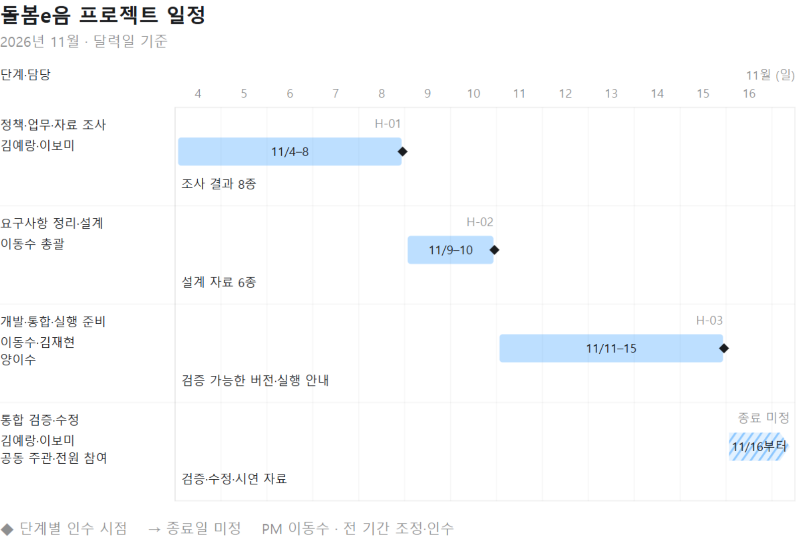

# Dolbom-eum 돌봄e음

A public service platform simplifying access to integrated community care.

돌봄e음 팀의 프로젝트 계획과 산출물을 관리하는 저장소입니다.

## 프로젝트 일정



검증·수정은 **김예랑·이보미 공동 주관, 전원 참여**로 진행합니다. 검증 종료일과 최종 제출일은 미정입니다.

## 프로젝트 문서

| 문서 | 용도 |
| --- | --- |
| [실행 계획](PLAN.md) | 담당자, 일정, 단계별 제출물과 인수 체크리스트 |
| [전체 프로젝트 운영 기획서](docs/PROJECT_PLAN.md) | 공식 자료를 바탕으로 한 조사 체계, 단계별 작업, 산출물 명세와 협업 방식 |
| [1차 시연 설계](docs/design/README.md) | 범위, 업무 상태, 화면, DB, API, 개발 작업과 H-02 인수 검토 |
| [조사 기록 양식](docs/templates/research-record.md) | 업무·자료·근거와 다음 단계에 전달할 결과 기록 |
| [인수인계 양식](docs/templates/handoff-record.md) | 전달자와 수신자의 자료·완료 조건 확인 |
| [작업 관리 양식](docs/templates/work-item.md) | 담당자·선행 작업·완료 기준·진행 상태 관리 |
| [검증 기록 양식](docs/templates/verification-record.md) | 기대 결과·실제 결과·오류 수정·재검증 기록 |

이번 문서는 **프로젝트를 어떻게 진행하고 단계마다 무엇을 전달할지** 정합니다. 제품의 기능, 화면, 데이터 구조, API, 기술 선택은 조사 이후의 별도 설계 산출물에서 정합니다.

## 이미지와 도표

공식 절차와 서비스 분류를 참고하는 이미지 2개를 [기획서](docs/PROJECT_PLAN.md#policy-reference)에 포함했습니다. 출처는 [이미지 안내](docs/assets/policy/README.md)에 기록합니다.

Markdown은 이미지 파일의 경로를 참조합니다. 이미지도 함께 커밋하면 GitHub에서 문서 안에 표시됩니다.

```markdown

```

프로젝트 진행도는 수정하기 쉬운 Mermaid 코드로 작성했고, 위 간트차트는 PNG 이미지로 저장했습니다.

## 기준 자료

- [보건복지부 지역사회 통합돌봄 누리집](https://www.mohw.go.kr/integratedcare/)
- [지역사회 통합돌봄 한 눈에 보기](https://www.mohw.go.kr/menu.es?mid=a60100000000)
- [지역사회 통합돌봄 이용안내](https://www.mohw.go.kr/menu.es?mid=a60200000000)

계획 기준일: **2026년 11월 4일**. 진행 상태는 [실행 계획](PLAN.md)에서 관리합니다.
