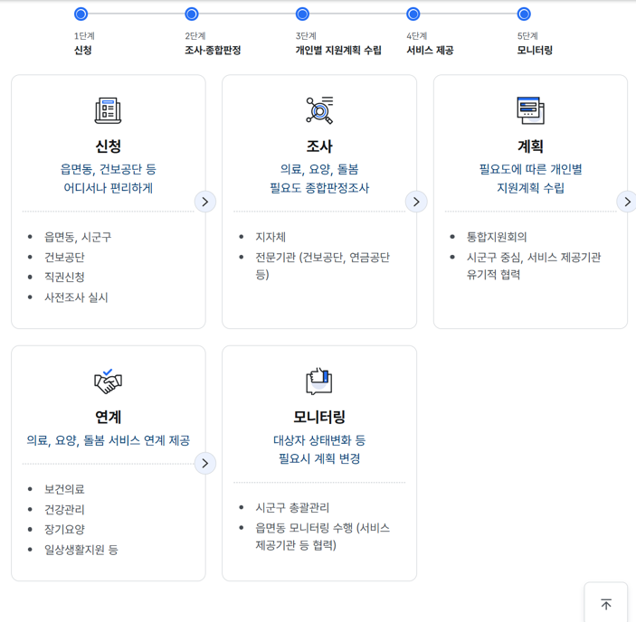
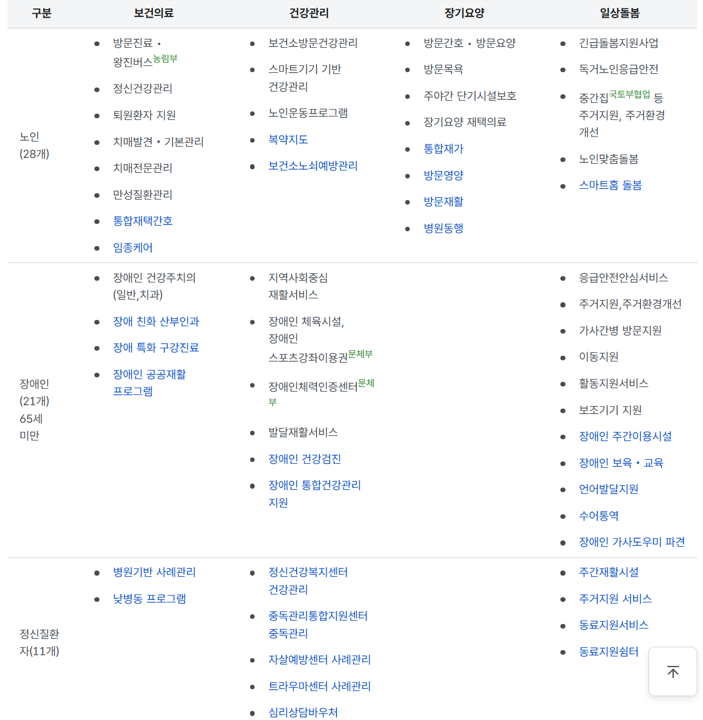

# 돌봄e음 프로젝트 운영 기획서

기준일: **2026년 11월 11일**

팀: P들의반란

PM: 이동수

문서 상태: 프로젝트 운영 기준안

돌봄e음 프로젝트는 공식 통합돌봄 업무와 자료를 조사한 뒤, 조사 결과를 설계·개발·검증으로 인계하는 순서로 진행한다. 이 문서는 **누가 언제 무엇을 하고, 어떤 결과물을 다음 담당자에게 넘겨야 하는지** 정한다.

제품의 기능 목록, 구체적인 화면, DB 구조, API 경로, 기술 스택은 여기서 결정하지 않는다. 해당 내용은 조사 자료를 인수한 뒤 설계 단계에서 별도 산출물로 작성한다.

[실행 계획과 체크리스트](../PLAN.md) · [조사 양식](templates/research-record.md) · [인수인계 양식](templates/handoff-record.md) · [작업 양식](templates/work-item.md) · [검증 양식](templates/verification-record.md)

## 목차

1. [공식 자료를 프로젝트에 적용하는 방법](#policy-reference)
2. [목표와 완료 판단](#objectives)
3. [팀 구성과 책임](#team)
4. [전체 일정과 진행 방식](#schedule)
5. [1단계 조사와 자료 정리](#research)
6. [2단계 요구사항 정리와 설계](#design)
7. [3단계 개발과 통합](#development)
8. [4단계 검증과 최종 인수](#verification)
9. [단계별 인수인계](#handoff)
10. [문서 관리와 협업](#collaboration)
11. [위험과 확인 과제](#open-items)
12. [최종 제출물과 참고자료](#delivery)

<a id="policy-reference"></a>

## 1 공식 자료를 프로젝트에 적용하는 방법

### 1.1 확인한 공식 업무의 틀

보건복지부는 통합돌봄 절차를 **신청 → 조사·종합판정 → 개인별 지원계획 수립 → 서비스 제공 → 모니터링**으로 제시한다. 지자체와 전문기관, 제공기관 등이 과정에 참여한다. 이 구조는 김예랑의 업무 조사 범위와 단계 간 인수 관계를 정리하는 기준으로 사용한다. [근거: 제도 개요·절차](https://www.mohw.go.kr/menu.es?mid=a60100000000)



이미지는 사용자가 제공한 공식 누리집 캡처다. 프로젝트 관리 단계와 구분하여 읽는다. 위 그림은 실제 돌봄 업무의 절차이고, 우리 팀의 진행 단계는 **조사·설계·개발·검증**이다.

### 1.2 공식 자료에서 도출하는 프로젝트 운영 방향

다음 표는 공식 안내를 읽고 정리한 **프로젝트 운영상의 제안**이다. 제품의 구현 방식을 정한 내용은 아니다.

| 공식 안내에서 확인할 관점 | 프로젝트에서 해야 할 일 | 조사 후 남아야 할 결과 |
| --- | --- | --- |
| 업무가 신청부터 모니터링까지 연결됨 | 각 단계의 이전 자료와 다음 결과를 함께 조사 | 단계별 입력·처리·결과·수신자 관계표 |
| 여러 기관과 담당 주체가 참여함 | 수행·판단·전달·협력 역할을 구분 | 업무 주체와 책임, 협의가 필요한 지점 |
| 사전조사와 조사 유형 등의 분기가 있음 | 정상 흐름과 분기·예외를 별도로 확인 | 분기 근거와 추가 확인 과제 |
| 서비스가 대상과 분야별로 구분됨 | 공식 분류와 지역 자료를 함께 대조 | 분류표, 자료 출처, 지역별 차이 |
| 계획 변경과 후속 검토가 있음 | 최초 결과뿐 아니라 변경·재검토 시 필요한 자료를 조사 | 변경 전후에 이어지는 기록과 근거 목록 |

신청·사전조사·조사 유형·지원계획·기관 연결·모니터링의 구체적인 절차는 [공식 이용안내](https://www.mohw.go.kr/menu.es?mid=a60200000000)를 기준으로 조사한다. 법정 필수 항목과 실제 승인 권한은 관련 서식·사업 안내까지 확인해 기록한다.

### 1.3 서비스 분류를 조사하는 방법

공식 안내는 보건의료·건강관리·장기요양·일상돌봄 등의 구분 아래 대상별 서비스 예시를 제시한다. 이보미는 이를 출발점으로 자료를 분류하되, 지역별 제공 여부·조건·기관과 원문 기준일을 따로 확인한다. [근거: 지원내용](https://www.mohw.go.kr/menu.es?mid=a60100000000)



이 표는 **조사 자료의 범위를 이해하기 위한 참고**다. 표에 나온 모든 서비스를 개발하거나, 서비스 수를 그대로 프로젝트 범위로 삼는 결정을 여기서 하지 않는다. 원문 분류와 팀이 정리한 분류를 대응시켜 차이를 남긴다.

<a id="objectives"></a>

## 2 목표와 완료 판단

### 프로젝트 운영 목표

- 조사자가 찾은 자료를 설계 담당자가 다시 조사하지 않고 사용할 수 있게 한다.
- 설계 자료만으로 개발자 간 담당 경계와 연결 조건을 이해할 수 있게 한다.
- 개발 결과를 다른 팀원이 같은 조건에서 실행하고 검증할 수 있게 한다.
- 최종 결과의 완료·미완료·제한사항을 근거와 함께 설명할 수 있게 한다.

### 단계별 완료를 판단하는 질문

| 시점 | 완료를 판단하는 질문 |
| --- | --- |
| 조사 완료 | 이동수가 필요한 업무·자료·분기를 이해하고 설계를 시작할 수 있는가? |
| 설계 완료 | 김재현·양이수가 핵심 요구사항을 새로 판단하지 않고 작업을 시작할 수 있는가? |
| 개발 인수 | 김예랑·이보미가 개발자의 실시간 설명 없이 실행·검증할 수 있는가? |
| 최종 인수 | 합의한 기준의 충족 여부와 남은 제약을 근거로 확인할 수 있는가? |

자료를 작성한 상태와 다음 담당자가 인수한 상태는 구분한다. 실제 인수 기록이 있어야 해당 단계의 완료로 본다.

<a id="team"></a>

## 3 팀 구성과 책임

| 담당자 | 프로젝트에서 맡을 책임 | 주로 받는 자료 | 반드시 넘길 결과 |
| --- | --- | --- | --- |
| 이동수 | PM, 조사 인수, 설계 총괄, 담당 개발, 통합·최종 인수 | 김예랑·이보미의 조사 자료, 분야별 검토 의견 | 설계 자료, 개발 작업표, 결정 기록, 통합·인수 결과 |
| 김재현 | UI/UX·프론트엔드 분야 검토와 개발 | 업무 흐름, 요구사항, 설계 자료 | 검토 의견, 담당 구현 결과, 사용·검증 안내 |
| 양이수 | 백엔드·DB·인터페이스·서버 분야 검토와 개발 | 자료 정의, 요구사항, 설계 자료 | 검토 의견, 담당 구현 결과, 실행·배포·복구 안내 |
| 김예랑 | 행정 절차·서류·분기 조사, 대표 사례, 이보미와 공동 검증 주관 | 공식 정책·서식, 인수한 개발 버전 | R-01~04, 공동 검증표·오류 목록·재검증 결과 |
| 이보미 | 공공자료·서비스·기관 조사, 분류·정제와 품질 확인, 김예랑과 공동 검증 주관 | 공식 서비스 안내, 지역 자료, 공개 데이터, 인수한 개발 버전 | R-05~08, 자료 품질·이용 조건 확인, 공동 검증 결과 |

이동수가 PM과 개발을 함께 맡으므로, 각 담당자는 자신의 자료 정리·진행 갱신·검토 요청까지 맡는다. PM은 우선순위와 범위·일정의 영향을 판단하고, 모든 원문 자료를 대신 정리하지 않는다.

업무별 책임자는 한 명을 정하고 협업자를 표시한다. 분야가 걸치는 작업은 입력·결과·검토자를 명시한 뒤 착수한다. 이름만 나란히 적고 책임이 나뉘지 않은 작업은 D-06에서 정리한다.

<a id="schedule"></a>

## 4 전체 일정과 진행 방식

[작업별 마감과 선행관계](development/WORK_SCHEDULE.md)를 기준으로 진행한다.

검증·수정은 김예랑·이보미 공동 주관, 전원 참여로 진행한다. 11월 16일까지 앱을 완성하고 17일까지 최종 자료를 인계한다.

| 단계 | 기간 | 핵심 작업 | 인수 시점 |
| --- | --- | --- | --- |
| 1 조사 | 11월 4~8일 | 공식 업무·서류·자료 조사와 구조화 | 11월 8일 H-01 |
| 2 설계 | 11월 9~10일 | 조사 인수, 요구사항·설계·작업 배정 | 11월 10일 H-02 |
| 3 개발·통합·첫 배포 | 11월 11~14일 | 12일 첫 통합, 13일 기능 연결, 14일 배포·실행 준비 | 11월 14일 H-03 |
| 4 검증·수정·앱 완료 | 11월 15~16일 | 전체 검증·오류 수정, 최종 배포·재검증 | 11월 16일 앱 완료 확인 |
| 5 최종 자료 인계 | 11월 17일 | 동일 버전의 실행·시연·제출 자료 정리 | 11월 17일 H-04 |

날짜는 2026년 기준이다. 앱 완료는 11월 16일, 최종 자료 인계는 17일이다. 제출 시각·형식은 이동수가 확인한다. [실행 계획](../PLAN.md)

조사 기간에도 개발자는 필요한 질문과 예상 인수 조건을 검토한다. 개발 기간에는 조사팀이 자료 품질과 검증 준비를 진행한다. 인수할 핵심 결과가 나오기 전에 다음 단계의 상세 내용을 임의 확정하지 않는다.

<a id="research"></a>

## 5 1단계 조사와 자료 정리

### 입력과 수행

입력은 공식 누리집·이용안내·사업 안내·신청 관련 서식·지역별 서비스 자료다. 김예랑은 업무와 서류, 이보미는 서비스와 자료를 조사한다. 두 사람은 같은 [조사 기록 양식](templates/research-record.md)을 사용한다.

원문 내용을 모으는 데서 끝내지 않고, **업무의 주체·이전 자료·처리·결과·다음 수신자**를 연결한다. 출처마다 문서명·URL·근거 위치·자료 기준일·팀 확인일을 구분한다.

### 5.1 김예랑의 산출물

| ID | 결과물 | 반드시 들어갈 내용 | 다음 단계의 사용 목적 |
| --- | --- | --- | --- |
| R-01 | 단계별 업무 흐름표 | 5단계별 주체·시작 조건·입력·처리·결과·수신자 | 업무의 연결과 설계 대상 이해 |
| R-02 | 서류·입력 항목 대조표 | 서식명·사용 시점·작성 주체·항목·작성 조건·출처 | 이후 요구사항과 정보 설계의 근거 |
| R-03 | 분기·예외·확인 과제 표 | 정상 흐름에서 달라지는 조건·근거·불확실한 질문 | 누락된 업무와 설계 판단 과제 확인 |
| R-04 | 대표 업무 사례·검증 관점 | 정상·분기·보완 또는 변경 사례의 시작·종료와 기대 결과 | 설계 검토와 검증 시나리오의 출발점 |

R-04는 우선 대표 사례 3개 이상을 목표로 작성한다. 사례는 업무를 설명하기 위한 것이며 제품 기능을 확정하는 요구사항으로 바로 간주하지 않는다.

### 5.2 이보미의 산출물

| ID | 결과물 | 반드시 들어갈 내용 | 다음 단계의 사용 목적 |
| --- | --- | --- | --- |
| R-05 | 자료 출처·이용 조건 목록 | 제공기관·자료명·수집 방법·URL·기준일·확인일·이용 조건 | 실제 사용할 수 있는 자료인지 판단 |
| R-06 | 서비스 분류·지역 차이 표 | 공식 대상·분야 구분, 지역별 명칭·조건·기관의 차이 | 자료의 공통점과 차이 이해 |
| R-07 | 수집 자료 필드 정의서 | 원문 항목의 의미·형식·누락·중복·출처와 정제 규칙 | 이후 데이터 설계와 정제 작업의 입력 |
| R-08 | 정제 표본과 샘플 JSON | 원문과 대응되는 대표 표본, 정제 전후 설명, 미확인 항목 | 자료를 실제로 읽고 연결할 수 있는지 확인 |

R-07은 **조사 자료의 항목을 설명하는 문서**다. 제품 DB 컬럼을 이 단계에서 확정하는 문서는 아니다. 표본의 수와 지역 범위는 자료 확보 결과를 보고 이동수와 정한다.

### 5.3 공식 5단계별 조사 결과

아래의 결과·기록은 조사해야 할 범주를 정리한 것이다. 법정 서식명·필수 항목·승인 권한은 조사팀이 원문에서 확인한다.

| 공식 업무 단계 | 앞 단계에서 확인할 자료 | 이번 단계에서 조사할 것 | 조사 후 남길 결과 | 다음 단계에 전달할 내용 |
| --- | --- | --- | --- | --- |
| 신청 | 대상·신청 주체·관할·관련 서류 | 창구·신청 방법·접수·사전조사의 위치와 처리 관계 | 신청·접수·사전조사 흐름, 서류·안내·분기 근거 | 조사로 넘겨야 할 자료와 경로 |
| 조사·종합판정 | 접수·사전조사 결과와 관련 자료 | 조사 주체·유형·조사 결과의 정리와 전달 | 조사 경로·결과 기록·지원 필요 내용을 설명한 자료 | 계획 수립에 필요한 조사 결과 |
| 개인별 지원계획 | 조사 결과와 이용 가능한 서비스 정보 | 계획 수립·검토·회의·변경의 주체와 절차 | 계획과 검토 결과의 관계, 관련 서류·변경 근거 | 서비스 의뢰·안내에 필요한 계획 자료 |
| 서비스 제공 | 계획과 서비스·기관 정보 | 사업부서·기관 의뢰와 대상자 안내의 차이 | 연결 방식과 제공 결과 기록의 관계, 서비스·기관 자료 | 이용과 후속 확인에 필요한 내역 |
| 모니터링 | 계획과 서비스 제공 내역 | 이용·만족·상태 변화 확인, 변경·종결 검토 관계 | 후속 확인 기록과 계획 재검토에 쓰는 자료 | 계획 변경·종결 검토의 입력 자료 |

공식 업무의 상세한 분기와 기록 범주는 [이용안내의 각 단계](https://www.mohw.go.kr/menu.es?mid=a60200000000)에서 확인한다. 이 표는 실제 시스템의 데이터 모델이나 필드 명세가 아니다.

### 완료 조건과 미완료 대안

H-01에서 이동수는 R-01~08을 함께 읽고 용어·업무·자료의 연결을 확인한다. 김재현·양이수는 이후 설계에 필요한 정보가 누락됐는지 검토한다.

자료가 없거나 조건이 불분명하면 `확인 필요`와 그 이유를 남긴다. 확인된 자료와 미확인 자료를 분리해 설계를 시작할 수 있는 범위를 판단한다. 미확인 내용을 팀의 추정으로 공식 사실처럼 채우지 않는다.

<a id="design"></a>

## 6 2단계 요구사항 정리와 설계

### 입력과 수행

입력은 H-01에서 인수한 조사 자료와 남은 확인 과제다. 이동수가 설계를 총괄하고 김재현·양이수가 분야별 실행 가능성과 연결 조건을 검토한다. 김예랑·이보미는 설계의 업무·자료 해석이 원문과 맞는지 확인한다.

이 단계에서 비로소 이번 작업 범위와 세부 설계를 정한다. 필요한 논점이 있으면 조사 근거·선택안·영향을 기록한 뒤 결정한다.

### 출력

| ID | 설계 단계가 만들어야 할 문서 | 인수 시 확인할 점 |
| --- | --- | --- |
| D-01 | 요구사항·범위 정의서 | 근거·작업 범위·제외 항목·완료 기준의 연결 |
| D-02 | 화면 정의서 | 사용 주체·입력·처리·결과와 이동·오류 조건 |
| D-03 | 정보·DB 설계서 | 자료 관계·재사용·보존·수정·접근 범위 |
| D-04 | 인터페이스·API 명세 | 개발자 간 입력·출력·오류·권한·연결 계약 |
| D-05 | 업무·상태 전이 정의서 | 시작·종료·전환 주체·분기·예외 |
| D-06 | 개발 작업표 | 담당자·기한·선행 작업·결과물·검증 기준 |

기술 선택·실행 환경·배포 조건은 이 단계의 결정 기록에 남긴다. 이전 자료에서 제시된 후보를 이미 확정된 것으로 취급하지 않는다.

### 완료 조건과 미완료 대안

H-02에서는 개발자가 핵심 요구사항을 다시 결정해야 하는 빈틈이 없는지 확인한다. 공통 부분과 담당 경계, 변경 협의 방법, 검증할 기준이 필요하다.

핵심 조건이 남아 있으면 담당·기한을 정한다. 독립적으로 진행 가능한 작업과 보류할 작업을 구분한다. 일정상 어려운 범위는 D-01과 D-06을 함께 조정하고 변경 근거를 기록한다.

<a id="development"></a>

## 7 3단계 개발과 통합

### 입력과 수행

입력은 H-02에서 인수한 D-01~06과 결정 기록이다. 이동수·김재현·양이수는 배정받은 작업을 수행하고, 매일 통합 상태와 담당 경계를 확인한다. 이보미는 자료 적용·품질을 확인하고, 김예랑은 검증 자료와 절차를 준비한다.

11월 11~14일의 세부 구현 순서는 D-06에서 정한다. 프로젝트 차원의 운영 순서는 다음과 같다.

| 시점 | 프로젝트 차원에서 확보할 결과 |
| --- | --- |
| 11월 11일 | 작업 배정·실행 환경·연결 조건 확인, 담당 작업 착수 |
| 11월 12~13일 | 첫 통합과 기능 연결, 자료 적용 확인, 검증 절차 준비 |
| 11월 14일 | 첫 배포, 실행·자료·제약 설명과 H-03 인수 |

### 출력

| ID | 개발 단계의 결과물 | 필수 포함 내용 |
| --- | --- | --- |
| B-01 | 담당 구현 결과와 통합 소스 | 연결 작업 ID, 변경 내역, 담당자 확인 |
| B-02 | 검증 가능한 실행 버전 | 버전·커밋, 실행 또는 접속 방법, 준비 상태 |
| B-03 | 실행·배포·초기화·복구 안내 | 환경 준비, 설정, 실행, 재실행·복구 절차 |
| B-04 | 시험 자료 | 가상 계정·업무 사례·필요 자료·초기 조건 |
| B-05 | 개발 인수 자료 | 구현·미구현 목록, 알려진 오류, 제약, 확인 방법 |

### 완료 조건과 미완료 대안

H-03에서는 김예랑·이보미가 같은 버전과 자료로 검증을 시작할 수 있어야 한다. 실행 안내와 실제 결과가 일치하는지 다른 팀원이 확인한다.

배포가 지연되면 동일 버전의 재현 가능한 실행 방법을 우선 확보하고, 배포 미완료를 별도 기록한다. 실행·연결·자료 준비가 끝나지 않은 항목을 단순히 개발 완료로 넘기지 않는다.

<a id="verification"></a>

## 8 4단계 검증과 최종 인수

### 입력과 수행

입력은 B-01~05, 설계 단계의 완료 기준, 조사에서 정리한 대표 사례다. 김예랑·이보미가 공동으로 검증을 주관하고 결과를 취합한다. 두 사람은 업무 적합성과 자료 품질을 함께 확인하며, 개발팀도 확인·오류 수정·재검증에 참여한다.

검증은 합의한 기준을 대상으로 한다. 정상 작업뿐 아니라 분기·예외, 자료 연결, 담당 경계, 실행 재현성과 결과 보존 등 필요한 관점을 설계 인수 시 구체화한다. 여기서는 개별 제품 기능의 테스트 항목을 미리 확정하지 않는다.

### 출력

| ID | 결과물 | 필수 포함 내용 |
| --- | --- | --- |
| V-01 | 실행한 검증표 | 입력·순서·기대 결과·실제 결과·근거·판정·버전 |
| V-02 | 오류·쟁점 목록 | 재현 조건·영향·담당·수정 목표·상태 |
| V-03 | 수정·재검증 이력 | 원래 오류와 수정 버전·재검증 결과의 연결 |
| V-04 | 최종 검증 보고·제한사항 | 완료·미완료·보류·남은 영향과 대응 |
| V-05 | 최종 실행·시연·제출 자료 | 실행 가능한 버전, 설명 자료, 제출물 위치 |

### 완료 조건과 미완료 대안

실제 결과와 증거를 채운 뒤 판정한다. 수정한 항목은 같은 절차로 재검증한다. 최종 버전과 검증 근거의 버전이 일치해야 한다.

실패·보류 항목은 남은 영향과 대체 방안을 기록한다. 이동수는 합의한 완료 기준과 제출 조건을 근거로 H-04를 판정한다. 제출 일정에 영향을 주는 변경은 결정 기록과 실행 계획에 함께 반영한다.

<a id="handoff"></a>

## 9 단계별 인수인계

| ID | 전달자 → 수신자 | 받을 입력 | 전달할 결과 | 완료 판단 | 미완료 시 조치 |
| --- | --- | --- | --- | --- | --- |
| H-01 | 김예랑·이보미 → 이동수 | 공식 자료와 조사 기준 | R-01~08·확인 과제 | 설계에 필요한 업무·자료·근거가 연결됨 | 누락 질문과 담당·기한 기록, 설계 가능 범위 구분 |
| H-02 | 이동수 → 김재현·양이수 | 인수한 조사 자료 | D-01~06·결정 기록 | 담당 경계와 구현·검증 기준이 명확함 | 설계 보완 또는 범위 조정, 독립 작업 우선 진행 |
| H-03 | 개발팀 → 김예랑·이보미, 전원 확인 | 인수한 설계 자료 | B-01~05 | 같은 버전·자료로 독립적인 검증 가능 | 실행·배포·자료 누락과 대체 방법 기록 |
| H-04 | 김예랑·이보미 취합·전원 → 이동수 | 실행 버전과 검증 기준 | V-01~05 | 충족 여부·수정 결과·제약을 근거로 판단 가능 | 재검증 또는 미완료 범위·일정 영향 기록 |

### 인수 기록의 필수 항목

- 전달자·수신자·전달일·검토일.
- 산출물 ID, 파일·링크, 버전 또는 커밋.
- 완료 기준과 확인 근거.
- 미완료·누락·불일치, 담당자·기한·대체 방안.
- 인수·조건부 인수·보완 후 재검토 중 판정과 이유.

조건부 인수는 남은 조건·해결 책임·기한이 있을 때만 사용한다. 판정 전까지 파일의 존재만으로 다음 단계 준비가 끝났다고 보고하지 않는다.

<a id="collaboration"></a>

## 10 문서 관리와 협업

### 10.1 저장소 구조

현재 작성한 프로젝트 관리 문서는 다음과 같다.

```text
README.md
PLAN.md
docs/
  PROJECT_PLAN.md
  assets/policy/
    README.md
    care-process.png
    service-categories.png
  templates/
    research-record.md
    handoff-record.md
    work-item.md
    verification-record.md
```

조사·설계·검증 결과가 나오면 `docs/research/`, `docs/design/`, `docs/verification/`, `docs/handoffs/` 등에 모으는 것을 기준으로 한다. 이 경로들은 앞으로 작성할 산출물의 권장 위치이며, 현재 결과가 완성되어 있다는 뜻은 아니다. 개발 소스 구조는 설계 단계에서 정한다.

### 10.2 자료와 진행 상태

| 구분 | 기록 기준 |
| --- | --- |
| 상태 | 미착수 / 진행 중 / 검토 요청 / 보완 중 / 완료 / 보류 |
| 작업 | 담당자 한 명, 협업자·검토자·기한·선행 작업·결과물·완료 기준 |
| 근거 | 공식 자료명·기관·URL·페이지 또는 소제목·자료 기준일·확인일 |
| 버전 | 검토·인수·검증에 사용한 문서 버전 또는 커밋 |
| 결정 | 논점·근거·결정자·결정일·일정과 다음 산출물에 미치는 영향 |
| 변경 | 바뀐 내용, 변경 이유, 영향을 받는 자료와 담당자, 재확인 여부 |

매일 각 담당자는 완료한 결과, 다음 작업, 필요한 결정·자료를 공통 작업표에 갱신한다. PM은 취합된 내용으로 의존 관계와 일정 영향을 판단한다. 진행을 막는 사안은 답변이 필요한 사람·기한과 먼저 진행할 수 있는 작업을 함께 남긴다.

### 10.3 범위와 일정 변경

조사 결과나 구현 여건으로 범위가 달라지면 근거와 영향을 남긴다. 이동수가 우선순위를 결정하고 관련 담당자가 다음 산출물과 검증 기준을 갱신한다. 같은 작업을 설명하는 문서가 서로 다른 범위를 유지하지 않게 한다.

<a id="open-items"></a>

## 11 위험과 확인 과제

### 운영 위험과 대응

| 위험 | 나타나는 신호 | 대응 |
| --- | --- | --- |
| 조사 자료를 다음 단계에서 쓸 수 없음 | URL만 있고 업무·입력·결과가 없음 | 조사 양식으로 재정리하고 H-01에서 사용 가능성 확인 |
| PM에게 정리·판단·개발이 집중됨 | 모든 자료 수정과 상태 취합이 이동수에게 돌아옴 | 담당자가 산출물·상태 갱신까지 책임지고 PM은 범위·우선순위 판단 |
| 개발자 간 담당 경계가 불명확함 | 같은 일을 중복 구현하거나 연결 부분이 비어 있음 | D-04·06에서 입력·출력·공통 부분·수신자를 명시 |
| 자료가 오래되거나 지역마다 다름 | 기준일·이용 조건·원문 연결이 없음 | R-05~08에서 근거와 차이를 확인하고 미확인을 표시 |
| 짧은 개발 일정에서 통합이 늦어짐 | 각자 결과는 있으나 함께 실행하지 못함 | 12일 첫 통합, 13일 기능 연결, 14일 배포·검증 인계 |
| 검증·수정 시간이 확보되지 않음 | 개발 완료가 밀리거나 검증 없이 완료 표시 | 13일 기능 연결, 15일 검증·수정, 16일 재검증 일정을 지킨다. |

### 미확정 항목

| ID | 확인할 내용 | 담당자 | 목표 기한 | 결과를 반영할 곳 |
| --- | --- | --- | --- | --- |
| Q-01 | 공식 절차·분기·서식의 최신 근거와 확인이 필요한 조건 | 김예랑 | 11월 8일 | R-01~04, H-01 |
| Q-02 | 활용 가능한 지역 자료·출처·이용 조건·정제 가능 범위 | 이보미 | 11월 8일 | R-05~08, H-01 |
| Q-03 | 개발자별 실제 투입 시간과 분야별 작업 경계 | 이동수·김재현·양이수 | 11월 10일 | D-06 |
| Q-04 | 11월 16일 앱 완료·17일 최종 자료 인계, 제출 시각·형식·별도 GitLab 등록 여부 | 이동수 | 11월 17일 인계 전 | 실행 계획, 최종 제출 목록 |
| Q-05 | 실행·배포 환경과 준비 조건, 자료·운영 제약 | 양이수·이동수 | 11월 10일 | 설계 결정 기록, B-03 |

제품의 구체적인 범위와 기술 후보는 조사 인수 후 별도의 설계 과정에서 검토한다. 확인되지 않은 정책 조건이나 개발 범위를 이 운영 문서에서 확정하지 않는다.

<a id="delivery"></a>

## 12 최종 제출물과 참고자료

### 최종 제출물

| 묶음 | 제출할 내용 | 확인 책임 |
| --- | --- | --- |
| 조사 근거 | R-01~08, 미확정·해결 기록 | 김예랑·이보미 |
| 설계와 결정 | D-01~06, 변경·결정 이력 | 이동수, 김재현·양이수 검토 |
| 실행 결과 | B-01~05, 실제 실행 버전과 안내 | 이동수·김재현·양이수 |
| 검증 결과 | V-01~05, 오류·수정·재검증·제약 | 김예랑·이보미 공동 주관, 전원 참여 |
| 인수 기록 | H-01~04, 최종 판정과 사용 버전 | 이동수·각 수신 담당자 |

최종 인수에서는 문서·실행 버전·검증 결과가 같은 범위를 설명하는지 확인한다. 미실행·실패·미완료·제한사항은 결과와 함께 전달한다.

### 공식 참고자료

공식 페이지 확인일: **2026년 11월 4일**.

| 자료 | 이번 운영 계획에서의 사용 |
| --- | --- |
| [지역사회 통합돌봄 전용 누리집](https://www.mohw.go.kr/integratedcare/) | 정책·지역·자료실을 조사하는 진입 경로 |
| [지역사회 통합돌봄 한 눈에 보기](https://www.mohw.go.kr/menu.es?mid=a60100000000) | 제도 개요·5단계 절차·참여 주체·지원내용 |
| [지역사회 통합돌봄 이용안내](https://www.mohw.go.kr/menu.es?mid=a60200000000) | 단계별 업무·분기·기관 연결·후속 검토 조사 기준 |
| [정책자료](https://www.mohw.go.kr/board.es?mid=a60401000000&bid=0073) | 후속 사업 안내·개정자료·서식 조사 경로 |
| [신청 관련 서식](https://www.mohw.go.kr/board.es?act=view&bid=0073&list_no=1489873&mid=a60401000000) | R-02에서 원문과 입력 항목을 대조할 자료 |
| [지방정부 서비스 메뉴판](https://www.mohw.go.kr/menu.es?mid=a60600000000) | R-05~08에서 지역 자료를 찾는 경로 |

공식 자료는 해당 소제목과 원문 버전까지 확인해 인용한다. 첨부 이미지의 출처와 사용 범위는 [정책 이미지 안내](assets/policy/README.md)에 기록했다. 팀 역할과 일정은 기존에 공유한 단계별 산출물·인수인계 명세를 따른다.
