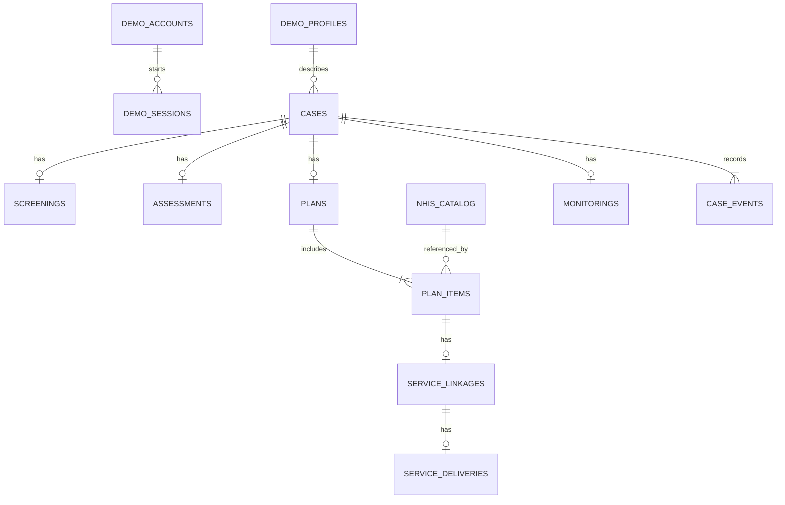

# D-03 정보와 DB 설계

가상 업무 기록과 공단 카탈로그는 SQLite 안에서 서로 다른 테이블로 관리한다. 사례의 관할은 가상 시연 프로필에서 가져오고, 공단 행의 지역은 자료의 원본과 표준값을 보존한다. 두 지역은 조회 초기값으로 연결한다. 카탈로그의 지역·기관명으로 사례의 접근 권한을 판정하는 작업은 두지 않는다. [R-07 데이터 필드](https://github.com/p-rebel/Dolbom-eum/blob/621f082/docs/research/R-07_service_field_definition.md) · [정제 데이터 안내](https://github.com/p-rebel/Dolbom-eum/blob/621f082/data/DATA_DOCUMENTATION.md)

## 테이블과 관계

| 테이블 | 키와 주요 필드 | 제약 |
| --- | --- | --- |
| `demo_accounts` | `id`, 계정명, 표시명, 비밀번호 해시, 역할, 시군구 코드, 읍면동 코드 | 계정명 고유. `TOWN`은 읍면동과 시군구, `DISTRICT`는 시군구에 소속. 표시명은 `Account.displayName`과 이력의 처리자 표시명에 사용. |
| `demo_sessions` | 토큰 해시, 계정 ID, 생성·만료 시각 | 계정 FK. 로그아웃 시 삭제. |
| `demo_profiles` | `code`, 가상 대상자·대리 신청인·안내대상 표시명, 지역 코드와 검색용 시도·시군구 | 시연용 목록에서 선택. 가상 식별용 코드와 표시명만 보유. |
| `cases` | `id`, 접수번호, 프로필 코드, 프로필 사본, 시군구 코드, 읍면동 코드, 생성 계정, 요청 키·해시, 접수일, 안내방식, 증빙 확인, 진행 상태, `version` | `id`는 서버가 발급하는 UUID 문자열. 접수번호 고유. 생성 계정·요청 키 조합 고유. 생성 시 `DemoProfile` 전체(표시명 3종과 `region`)를 JSON 사본으로 보존하고, 관할 조회용 시군구·읍면동 코드는 별도 컬럼에 복사. |
| `screenings`, `assessments` | 각각 신청 ID, 일자, 결과. 사전조사는 조사 방법, 판정은 수신일 포함 | 테이블별 신청 ID PK. |
| `plans` | 신청 ID, 수립일, 목표, 회의일, 회의 결과, 확정 담당자, 안내일 | 신청 ID PK. 회의 승인 시 확정 값 기록. 안내일은 확정 후 기록. |
| `plan_items` | `id`, 신청 ID, 순서, 카탈로그 버전·공단 행 ID, 선택 시점의 `CatalogItem` JSON 사본 | 계획 FK. 동일 계획에 같은 카탈로그 행 중복 불가. 초안을 교체하면 항목 ID를 새로 발급. 확정 후 보존. |
| `service_linkages` | 계획 항목 ID, 연계일, 연계 방식, 가상 부서·공단 수신처 | 계획 항목 ID PK. 부서·공단 방식에서만 수신처를 입력. 제공기관 방식은 계획 항목에 저장된 기관명 사용. |
| `service_deliveries` | 계획 항목 ID, 확인일, 제공 상태, 사유 | 연계된 계획 항목 ID PK. 미개시·거부 시 사유 필수. 갱신 전후 값은 이력에 보존. |
| `monitorings` | 신청 ID, 확인일, 방법, 상태 변화, 검토 필요·사유, 항목별 확인 결과 | 신청 ID PK. 기존 현황과 새 관찰을 반영한 결과를 계획 항목 순서의 JSON 배열로 저장. |
| `case_events` | `id`, 신청 ID, 동작, 처리 전·후 상태, 처리자, 처리 시각, 버전, 변경 요약, 변경 상세, 계획 항목 ID | 신청 ID·버전 조합 고유. 시연 계정의 역할·표시명 포함. 항목별 동작은 같은 사례의 계획 항목 ID를 참조하며 그 밖의 동작은 `null`. 변경 상세는 `{before, after}` JSON으로 제공 현황 갱신 등 변경 전후 값을 보존하며 API 응답에는 포함하지 않는다. |
| `nhis_catalog` | `dataset_version`·`nhis_service_id`, 원본 행 번호, 지역 원문·표준·별칭, 분류, 프로그램, 기관, 출처·기준일, 품질 플래그 | 버전·공단 행 ID 조합 PK. 계획 항목이 같은 조합을 참조. |

## 공단 자료 적재와 검색

1. `621f082`의 `data/processed/nhis_services.csv`를 UTF-8 BOM을 허용해 읽는다. 원본 행 번호, `nhis_service_id`, `source_name`, `source_url`, `reference_date`를 유지한다. v1.4 전체 입력은 90,081행이다. 적재 전 행 수·필수 헤더·ID 고유성, 적재 후 조회 표본을 확인한다.
2. `sido_raw`·`sigungu_raw`는 원문, `sido`·`sigungu`·`sigungu_gu`는 표준 표기, `sido_current`·`sido_legacy`는 시도 조회 별칭으로 유지한다. 시군구 조회는 표준 시군구에 맞춘다. 예를 들어 세종은 원본 시군구가 공란이며 표준 시군구에 `세종특별자치시`가 들어 있다. 시도만 선택하면 표준 시군구와 관계없이 해당 시도 결과를 조회한다.
3. 조회 대상은 `is_duplicate_extra=N`인 행이다. 프로그램이나 기관명에 대한 검색어는 공백을 정리하고 부분 문자열로 찾는다. 시도는 표준·현행·이전 표기 중 같은 값과 일치시키고, 시군구·대분류는 정확히 일치시킨다. 지역·분류 필터를 함께 주면 모두 충족하는 결과를 반환한다. 공단 행 ID 오름차순으로 결과를 고정한다.
4. 빈 CSV 필드는 `null`로 변환한다. 전화번호는 문자열로 보존한다. 기관명이 같거나 프로그램명이 비슷한 행은 각각 출처 행으로 취급한다. 메뉴판 자료와 매칭하거나 시연 배포 데이터에 포함하는 작업은 별도 결정 사항이다. [공단 정제 CSV](https://github.com/p-rebel/Dolbom-eum/blob/621f082/data/processed/nhis_services.csv) · [H-01 후속 조건](https://github.com/p-rebel/Dolbom-eum/blob/621f082/docs/handoff%20/H-01_research_data_handoff.md)

`v1.4`는 데이터 버전이다. 샘플 JSON 3종의 `meta.source_csv`는 저장소 루트 기준으로 공단 `data/processed/nhis_services.csv`와 지자체 `data/processed/local_services.csv`를 가리킨다. 공단 적재 입력은 1번의 고정 커밋과 파일을 사용한다.

## 무결성과 저장 방식

- 날짜는 업무일자 `YYYY-MM-DD`, 서버 처리 시각은 UTC ISO 8601로 저장한다. 사용자 화면에서는 처리 시각을 한국 시간으로 표시한다.
- SQLite 외래키 검사를 연결마다 활성화한다. 사례 생성 및 상태 변경은 `BEGIN IMMEDIATE`로 쓰기 트랜잭션을 연 뒤 현재 기록을 읽고 관련 테이블과 이력을 함께 저장한다. 갱신에는 `case_id + version` 조건을 적용하고, 선행 요청이 버전을 올렸으면 후행 요청을 버전 충돌로 처리한다.
- 연결마다 `PRAGMA foreign_keys=ON`, `PRAGMA busy_timeout=5000`을 설정하고 DB는 `journal_mode=WAL`로 연다. Python `sqlite3`는 암묵적 트랜잭션을 끄고(`isolation_level=None`) `BEGIN IMMEDIATE`를 직접 실행한다. 대기 시간이 없으면 동시 저장의 후행 요청이 버전 충돌 대신 잠금 오류(`500`)로 끝난다.
- 접수번호는 사례 생성과 같은 쓰기 트랜잭션에서 기존 최대 순번 + 1로 발급한다.
- 접수 요청 키에는 계정·입력값을 연결한다. 입력값 비교에는 `profileCode, receivedOn, noticeMethod, evidenceChecked` 네 필드를 키 정렬·공백 없는 UTF-8 JSON으로 만든 SHA-256 해시를 저장한다. 같은 키와 해시로 재시도하면 기존 사례를 반환한다. 같은 키에 다른 해시면 충돌로 처리한다.
- 확정 계획은 선택 당시 프로그램·기관·출처명·URL·기준일을 포함한 전체 `CatalogItem`을 보존한다. 초기화할 때 카탈로그 버전을 고정하고, 버전을 추가하는 경우 참조 중인 버전을 보존한다. [D-04 응답 구조](D-04_api.md)
- 시연 환경에서는 역할·관할 검증을 서버에 적용한다. 세션 비밀, 비밀번호, 업무 DB는 저장소와 브라우저 번들 밖에 둔다. 시연용 DB 초기화는 지정 경로에서만 수행하고, H-03에 초기화·백업·재실행 절차를 남긴다. 가상 계정 비밀번호는 저장소 밖의 환경값에서 시드 스크립트로 읽어 해시로만 저장한다. [SQLite 트랜잭션](https://sqlite.org/lang_transaction.html)
- 백업은 SQLite 백업 API(`sqlite3 .backup` 또는 Python `Connection.backup`)로 만든다. WAL 모드에서 실행 중인 DB 파일만 복사하면 `-wal` 파일의 변경이 빠진다. [SQLite 온라인 백업](https://sqlite.org/backup.html)
